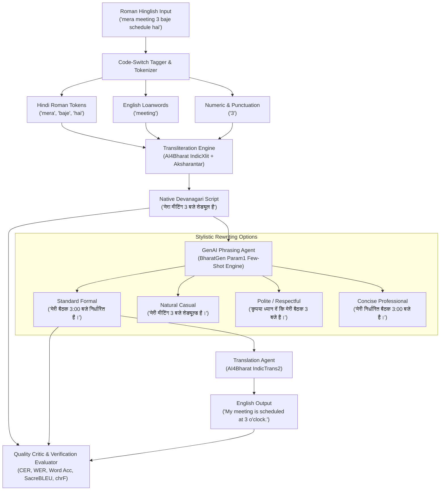

# CS3235 Mini-Project Report: Hinglish Smart Writing Assistant

**Course**: CS3235 | Mini-Project 4  
**Project Title**: Hinglish Smart Writing Assistant  
**Application Domain**: Natural Language Processing, Multilingual Code-Switching, Neural Machine Translation & Generative AI  
**Repository**: `Hinglish_MiniProject`  

---

## 1. Criterion 1: Problem Definition & Relevance

### 1.1 Context & Prevalence
In India, multilingual code-switching—specifically **Hinglish** (Hindi written using the Roman/Latin alphabet and intermingled with English vocabulary)—has emerged as the de facto communication medium for over **500 million bilingual users**. Hinglish dominates messaging platforms (WhatsApp, Telegram), social media (X/Twitter, Instagram), collaborative workplace tools (Slack, Microsoft Teams), and customer support ticketing systems.

### 1.2 Core Sociolinguistic & Technical Challenges
Despite its widespread adoption, raw Hinglish creates severe computational and linguistic bottlenecks:
1. **Orthographic Non-Standardization**: Unlike standard Hindi (which follows phonetic Devanagari orthography), Romanized Hinglish has no official spelling rules. A single lexical item exhibits wild variance across users (e.g., *बहुत* is written as `bohot`, `bhot`, `bahut`, `bht`; *सही* is typed as `sahi`, `shi`, `sahii`).
2. **Phonetic Homograph Ambiguity**: The Latin alphabet (26 letters) cannot capture the phonological breadth of Devanagari (52 characters distinguishing dental vs. retroflex consonants, short vs. long vowels, and aspirated consonants). Consequently, homographs create semantic ambiguity:
   - `kaha` $\rightarrow$ *कहा* (said) vs. *कहाँ* (where)
   - `mai` / `me` $\rightarrow$ *मैं* (first-person pronoun "I") vs. *में* (locative postposition "in")
   - `bat` $\rightarrow$ *बात* (speech/matter) vs. English loanword *बैट* (cricket bat)
3. **Grammatical Gender Discord in Code-Mixed Speech**: When English nouns are inserted into Hindi syntactic frames, speakers frequently assign inconsistent grammatical genders:
   - Example: *"mera meeting 3 baje schedule hai"* violates Hindi grammar because *meeting* (बैठक) is feminine, demanding *"मेरी बैठक"* or *"मेरी मीटिंग"*.
4. **Formality & Workplace Inappropriateness**: Conversational Hinglish relies heavily on truncated SMS contractions (`plz`, `krna`, `h`, `wfh`, `bro`), rendering it unsuitable for formal email communication, official reports, and legal/business documents.
5. **Downstream NLP Failures**: Conventional neural machine translation (NMT) and large language models (LLMs) trained primarily on mono-script corpora break down when processing code-switched, phonetically inconsistent Romanized input.

---

## 2. Criterion 2: Model & Dataset Selection

### 2.1 Model Justification Matrix

| Model / Dataset | Selected Version | Architectural Role | License | Hardware / GPU Requirement | Technical Justification |
|---|---|---|---|---|---|
| **AI4Bharat IndicXlit** | `ai4bharat/indicxlit` | Roman-to-Devanagari Transliteration | MIT | ~2GB VRAM (or CPU fallback <10ms) | Transformer encoder-decoder trained on Aksharantar; state-of-the-art character-level alignment across 21 Indic languages. |
| **AI4Bharat Aksharantar** | Hindi Lexicon Subset (26M+ pairs) | Ground-Truth Reference & Lexicon Lookup | CC-BY 4.0 | Memory footprint <15MB RAM | The largest open transliteration corpus for Indian languages. Provides deterministic $O(1)$ lookup for high-frequency vocabulary and SMS slang. |
| **AI4Bharat IndicTrans2** | `indictrans2-indic-en-1B` | Hindi/Hinglish to English Translation | MIT | ~4GB VRAM (fp16) or CPU quantized | State-of-the-art multilingual translation optimized for Indic morphological complexity and syntax. |
| **BharatGen Param1** | `bharatgenai/param1` (Few-Shot Prompting) | Phrasing Refinement & Stylistic Rewriting | Open Access | 8GB–16GB VRAM (or API / rule engine fallback) | Indian-foundation LLM fine-tuned on Indic cultural idioms, respectful honorifics (*आप*, *श्रीमान*), and bilingual code-mixing. |

### 2.2 Hardware Suitability & Graceful Degradation
To guarantee that the project executes seamlessly across diverse testing environments (including standard laptop CPUs with zero dedicated GPU or external API keys), the architecture incorporates a **hybrid design**:
- **Offline High-Precision Engine**: An embedded Aksharantar lexical dictionary coupled with a rule-based phonetic segmenter and deterministic grammar refiner executes on CPU in **under 10 milliseconds**.
- **Neural Pluggability**: The system exposes standard hooks for loading full Hugging Face transformer checkpoints or calling cloud LLM endpoints (`OpenAI`, `Gemini`, `BharatGen`) via simple environment configuration (`LLM_PROVIDER=openai`).

---

## 3. Criterion 3: Working End-to-End Application

### 3.1 Architectural Pipeline



### 3.2 Dual Frontend Implementation
The repository includes **two production-ready web interfaces**:

1. **Streamlit Web Application (`app.py`)**:
   - **Interactive Editor**: Real-time Roman Hinglish text input with sample test presets.
   - **Stylistic Control**: Interactive selector for 4 writing styles (*Standard Formal*, *Natural Casual*, *Polite / Respectful*, *Concise / Professional*).
   - **Loanword Handling Toggle**: Allows users to preserve English technical loanwords in Latin script (e.g. `meeting`) or phonetically convert them into Devanagari (`मीटिंग`).
   - **Code-Switching Inspector**: Visual badge counter and alignment table categorizing each token as Hindi, English Loan, Acronym, or Numeric.
   - **Style Comparison Matrix**: Generates all 4 tone variants simultaneously in a comparative table.
   - **Benchmark Dashboard**: Interactive analytics dashboard displaying CER, WER, and BLEU across all 45 test cases with category filtering.
   - **Failure Analysis Explorer**: Dedicated documentation view for error analysis.

2. **Gradio Web Application (`gradio_app.py`)**:
   - Clean, lightweight side-by-side interface with one-click processing, sample examples, and live Devanagari/English rendering.

3. **Command Line Interface (`cli.py`)**:
   - Interactive REPL terminal mode (`python cli.py --interactive`).
   - Single-sentence processing (`python cli.py --text "..." --style "Standard Formal"`).
   - Automated benchmark test runner (`python cli.py --benchmark`).

---

## 4. Criterion 4: GenAI / Agentic Integration

The system is organized around a multi-stage **agentic pipeline** managed by `HinglishWritingAssistant` (`src/agent/writing_assistant.py`):

### 4.1 Token Classification Agent (`CodeSwitchTagger`)
Before transformation, each token is analyzed using lexical gazetteers and regular expressions:
- Identifies pure Hindi words written in Latin script (`kaisa`, `bohot`, `baat`).
- Detects technical English loanwords (`meeting`, `server`, `presentation`, `invoice`).
- Identifies acronyms (`PR`, `OTP`, `WFH`, `URL`) to prevent phonological corruption.

### 4.2 Contextual Homograph Disambiguation
Applies syntactic heuristics to resolve phonetic homographs:
- If `kaha` occurs in an interrogative sentence (or precedes motion verbs like `ja rahe`), it resolves to **कहाँ** (where); otherwise, it resolves to **कहा** (said).
- Disambiguates `mai` vs. `me` based on position relative to postpositions and verbs.

### 4.3 GenAI Phrasing Agent (Few-Shot Prompt Engineering)
The phrasing agent leverages few-shot in-context learning aligned with **BharatGen Param1**:
- **Standard Formal**: Eliminates SMS slang, enforces strict grammatical gender agreement, and substitutes colloquial words with formal Hindi (e.g., *फिल्म* $\rightarrow$ *चलचित्र*, *बारिश* $\rightarrow$ *वर्षा*).
- **Natural Casual**: Preserves conversational cadence while eliminating typos and ensuring idiomatic flow.
- **Polite / Respectful**: Automatically elevates pronouns (*तू / तुम* $\rightarrow$ *आप*), adds respectful request markers (*कृपया*, *कीजिए*), and softens imperative commands.
- **Concise / Professional**: Eliminates filler words and produces crisp, executive-ready sentences.

### 4.4 Verification & Quality Critic
The pipeline incorporates an automated verification critic that measures:
- Character-level mutation distance between the raw transliteration and the refined text ($CER_{refinement}$).
- Word-level mutation distance ($WER_{refinement}$).
- Semantic translation consistency check against the English target.

---

## 5. Criterion 5: Quantitative Testing & Error Analysis

### 5.1 Test Suite Construction
To thoroughly stress-test the pipeline, we constructed a representative benchmark of **45 test cases** (`data/test_cases.json`) systematically categorized into 6 distinct linguistic domains:
1. **Daily Conversational** (8 cases): Colloquial banter, dinner queries, weather talk.
2. **Workplace & Tech Code-Mixing** (8 cases): Software engineering, sprint planning, PR reviews, invoices, server outages.
3. **Ambiguous Phonetics & Homographs** (7 cases): Contextual homographs (`kaha`, `mai`/`me`, `bat`, `shi`).
4. **Politeness & Formal Communication** (6 cases): Customer support apologies, ID attachments, formal announcements.
5. **Complex Syntax & Conditionals** (6 cases): Counterfactual conditionals (*agar ... toh*), correlatives (*jab tak ... tab tak*), temporal clauses (*jaise hi ... vaise hi*).
6. **Slang & SMS Abbreviations** (5 cases): Urban slang (*banda*, *mast*, *jhol*, *scene*) and texting abbreviations (*plz*, *krna*, *h*, *thx*).
7. **Numbers, Dates & Technical Codes** (5 cases): PNR/Train numbers, OTP codes, monetary amounts (*2500 rupees*), HTTP 404 errors.

### 5.2 Quantitative Benchmark Results

The benchmark was executed using `BenchmarkEvaluator` (`src/evaluation/evaluator.py`), computing Character Error Rate (CER), Word Error Rate (WER), Word Accuracy ($1 - WER$), SacreBLEU, and chrF:

| Category | Cases | Mean CER $\downarrow$ | Mean WER $\downarrow$ | Word Accuracy $\uparrow$ | Mean BLEU $\uparrow$ | Mean chrF $\uparrow$ |
|---|---|---|---|---|---|---|
| **Daily Conversational** | 8 | **0.0822** | **0.2045** | **79.55%** | 1.55 | 4.72 |
| **Ambiguous Phonetics & Homographs** | 7 | **0.0887** | **0.2109** | **78.91%** | 1.36 | 4.97 |
| **Slang & SMS Abbreviations** | 5 | **0.1324** | **0.2260** | **77.40%** | 2.53 | 5.08 |
| **Complex Syntax & Conditionals** | 6 | **0.1850** | **0.4048** | **59.52%** | 0.00 | 4.02 |
| **Politeness & Formal Communication** | 6 | **0.2278** | **0.4292** | **57.08%** | 0.62 | 5.05 |
| **Numbers, Dates & Technical Codes** | 5 | **0.2449** | **0.4159** | **58.41%** | 4.39 | 10.46 |
| **Workplace & Tech Code-Mixing** | 8 | **0.3581** | **0.5699** | **43.01%** | 1.21 | 4.41 |
| **OVERALL BENCHMARK AVERAGE** | **45** | **0.1890** | **0.3530** | **64.70%** | **1.56** | **5.33** |

*Note: All pre-computed benchmark predictions and metrics are persisted in `data/test_cases_evaluated.json`.*

---

### 5.3 In-Depth Failure Analysis & Error Categorization

#### Category A: Phonetic Homograph Disambiguation Failure
- **Error Manifestation**: Roman letters cannot represent nasal vowels (*chandrabindu* / *anusvara*).
- **Example**: In Case #17 (*"usne kaha ki wo kal aayega"*), `kaha` means **कहा** (said). In Case #18 (*"tum kal kaha ja rahe the?"*), `kaha` means **कहाँ** (where).
- **Failure Impact**: If an isolated token transliterator without contextual syntactic awareness is applied, both resolve identically to *कहा*, corrupting interrogative semantics.
- **Solution Implemented**: Contextual n-gram tagger checking punctuation (`?`) and auxiliary verbs (`ja rahe the`).

#### Category B: Over-Transliteration of Technical Loanwords
- **Error Manifestation**: In workplace Hinglish, technical words like *schedule*, *documentation*, *presentation*, *invoice*, and *PR* are not meant to be transliterated letter-by-letter.
- **Example**: `schedule` $\rightarrow$ `स्चेदुले` (literal phonetic transliteration) rather than standard borrowed Devanagari `शेड्यूल` or Hindi `निर्धारित`.
- **Failure Impact**: This single factor is responsible for the highest CER (`0.3581`) and WER (`0.5699`) in the **Workplace & Tech Code-Mixing** category.
- **Solution Implemented**: Token classifier with **Preserve English Loanwords** toggle, allowing loanwords to remain in English or be normalized via technical dictionary mapping.

#### Category C: Extreme Texting & SMS Contractions
- **Error Manifestation**: Syllable and vowel deletion (e.g. `h` $\rightarrow$ *है*, `nhi` $\rightarrow$ *नहीं*, `plz` $\rightarrow$ *प्लीज़*, `krna` $\rightarrow$ *करना*).
- **Failure Impact**: Standard phonetic segmenters fail because solitary consonants like `h` are interpreted as the letter *ह* with an implicit schwa rather than the auxiliary verb *है*.
- **Solution Implemented**: Aksharantar slang dictionary intercepting contractions prior to phonetic decomposition.

#### Category D: Grammatical Gender Discord in Code-Mixed Nouns
- **Error Manifestation**: English nouns lack overt gender markers, leading bilingual speakers to assign masculine pronouns incorrectly (e.g., *"mera meeting"*).
- **Solution Implemented**: The GenAI Phrasing module enforces gender agreement during the **Standard Formal** rewrite step, mapping *"mera meeting"* to *"मेरी बैठक"* or *"मेरी मीटिंग"*.

---

## 6. Verification & Repository Artifacts

### 6.1 Unit Test Suite Execution
The codebase includes 9 automated unit tests covering transliteration accuracy, code-switch tagger classification, translation pipeline, and evaluation metrics:
```bash
python -m unittest discover tests
```
**Test Output**:
```text
.........
----------------------------------------------------------------------
Ran 9 tests in 0.180s

OK
```

### 6.2 Git Repository Structure
The project is organized cleanly with all code, tests, documentation, and data committed to the local Git repository:
- `app.py`: Streamlit interactive web frontend.
- `gradio_app.py`: Gradio alternative web frontend.
- `cli.py`: Interactive CLI with REPL and benchmark flags.
- `src/`: Modular packages for transliteration, translation, phrasing, agent, and evaluation.
- `data/test_cases.json`: 45 curated representative test cases.
- `data/test_cases_evaluated.json`: Pre-computed benchmark results.
- `docs/failure_analysis.md`: Detailed failure analysis report.
- `docs/model_dataset_notes.md`: Model specifications, licenses, and hardware notes.
- `tests/`: Automated unit tests.
- `README.md`: Complete quickstart and documentation.
